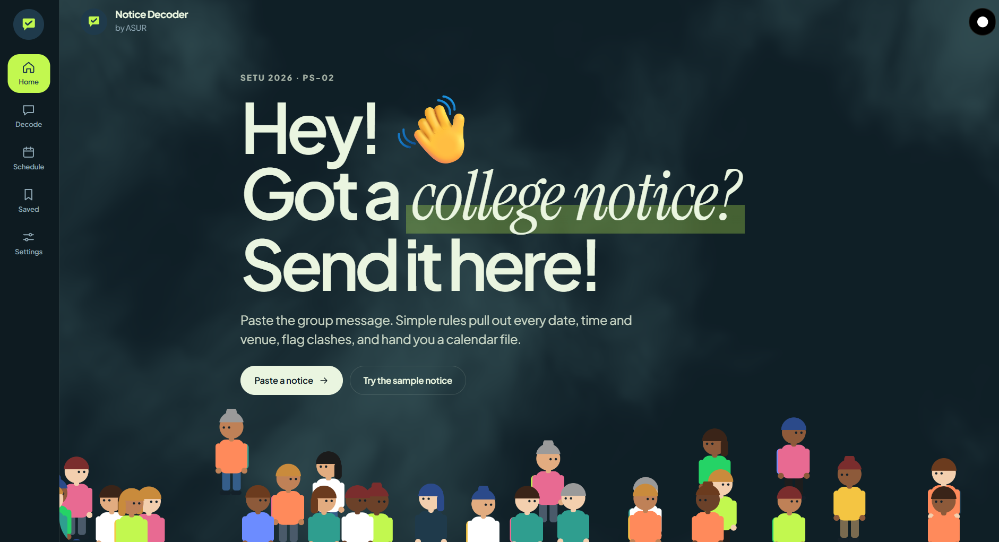
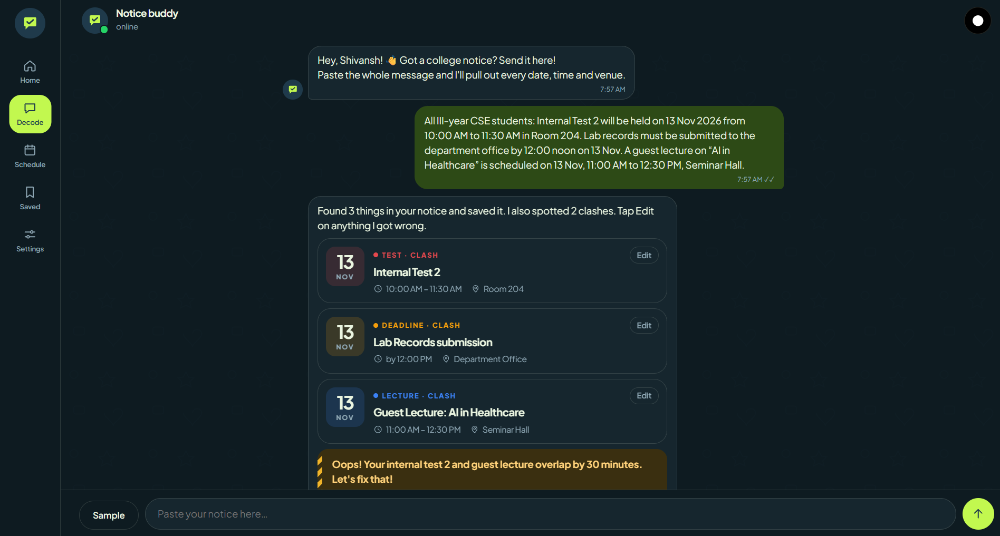
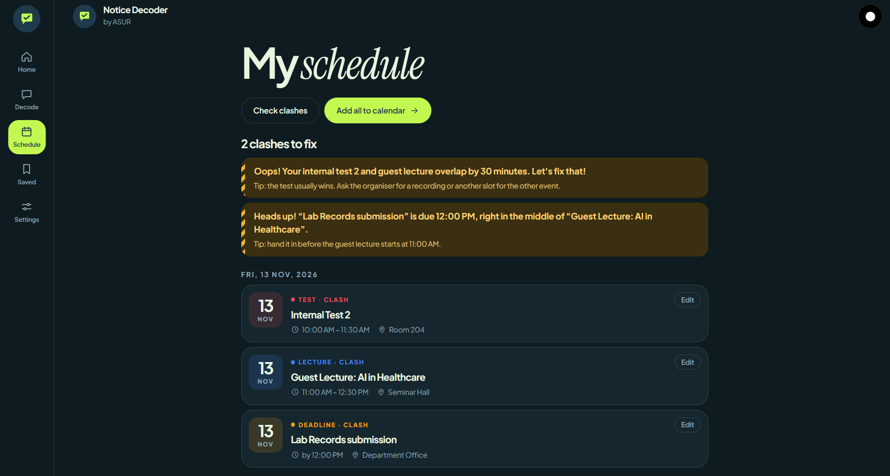
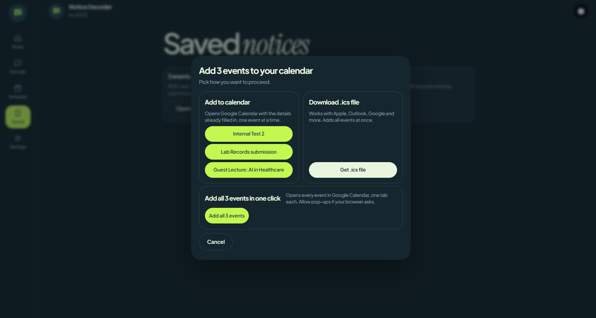
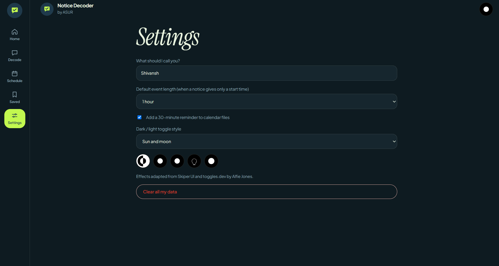
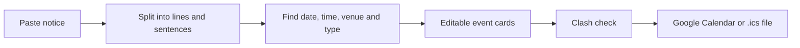

<div align="center">

# 💬 Notice Decoder by ASUR

**Nobody should find out about a clash on the morning of the test.**

Paste a college notice. Get your events, clashes caught early, and a calendar file.

[**Live demo**](https://YOUR-USERNAME.github.io/YOUR-REPO-NAME/) · [How it works](#-how-it-works) · [Clash rule](#-the-clash-rule) · [Run it](#-run-it)


<br>
<sub><b>Home page</b></sub>

</div>

---

## ✌️ Why we built it

- **The date is buried.** Notices arrive as long paragraphs on groups and boards, and the important date hides in the middle.
- **Clashes show up late.** A test, a lecture and a deadline can land on the same day, and students find out too late.
- **Copying is slow.** Typing dates into a calendar by hand is tedious, and one wrong digit means a missed deadline.

## 📱 Screens

<table>
  <tr>
    <td align="center"><br><sub><b>Decode</b></sub></td>
    <td align="center"><br><sub><b>Schedule</b></sub></td>
  </tr>
  <tr>
    <td align="center"><br><sub><b>Saved</b></sub></td>
    <td align="center"><br><sub><b>Settings</b></sub></td>
  </tr>
</table>

## 🧪 Try this sample

Paste this into the app:

> All III-year CSE students: Internal Test 2 will be held on 13 Nov 2026 from 10:00 AM to 11:30 AM in Room 204. Lab records must be submitted to the department office by 12:00 noon on 13 Nov. A guest lecture on "AI in Healthcare" is scheduled on 13 Nov, 11:00 AM to 12:30 PM, Seminar Hall.

You get:

| Event | Type | Date | Time | Venue |
|---|---|---|---|---|
| Internal Test 2 | Test | 13 Nov 2026 | 10:00 – 11:30 AM | Room 204 |
| Lab Records submission | Deadline | 13 Nov 2026 | by 12:00 PM | Department Office |
| Guest Lecture: AI in Healthcare | Lecture | 13 Nov 2026 | 11:00 AM – 12:30 PM | Seminar Hall |

And two warnings:
- ⚠️ The test and the guest lecture overlap by **30 minutes**.
- ⚠️ The records deadline falls in the middle of the lecture.

## ⚙️ How it works



1. **Paste it.** Drop in the notice exactly as it came on the group.
2. **Rules read it.** Simple pattern rules pull out the title, type, date, time and venue.
3. **You fix it.** Every field is editable, because automatic detection can be wrong.
4. **Clash check and export.** Clashes are flagged with a tip, then you add the events to your calendar.

## ⚖️ The clash rule

Two events clash if they are on the same day and their time slots overlap, even a little.

```
start(A) < end(B)  and  start(B) < end(A)
```

<details>
<summary><b>Examples</b></summary>

- Test 10:00 – 11:30 and lecture 11:00 – 12:30: **clash** (30 minutes overlap)
- Test 10:00 – 11:00 and lecture 11:00 – 12:00: **no clash** (back-to-back is fine)
- Different days: **never a clash**
- Deadline at 12:00 and a lecture 11:00 – 12:30: **clash** (a deadline is one moment, and it falls inside the lecture)
- Events with no time are not checked

</details>

## ✨ Features

- [x] Chat-style interface with a typing indicator
- [x] Finds several events in one notice, including one event per line
- [x] Detects Test, Lecture, Deadline or Event
- [x] Reads dates like `13 Nov 2026`, `Nov 13`, `13/11/2026` and times like `10:00 AM to 11:30 AM`, `4pm`, `12 noon`
- [x] Edit or delete any event
- [x] My Schedule grouped by day, with clashes at the top
- [x] Saved notices you can reopen later
- [x] Skips events it already has, so you never get double clashes
- [x] Add to Google Calendar, add all events in one click, or download an `.ics` file
- [x] Light and dark mode with five animated toggles
- [x] Responsive, touch-friendly, and respects "reduce motion"

## ▶️ Run it

**Online:** open the [live demo](https://YOUR-USERNAME.github.io/YOUR-REPO-NAME/).

**On your computer:** download `index.html` and open it in any browser. Nothing to install.

> The `.ics` file downloads straight to your Downloads folder when the app runs on its own. Some preview windows block this, and the app then shows the file text to copy.

## 🛠️ Built with

HTML, CSS and plain JavaScript in one file · WebGL cloud background · [GSAP](https://gsap.com) for the walking crowd · Google Fonts (Plus Jakarta Sans, Instrument Serif)

No backend and no accounts. Your notices and settings stay in your own browser.

## ⚠️ Note

- Extraction is rule-based, so unusual wording can be missed or misread. That is why every event is editable.
- Google Calendar links add one event at a time. Use the `.ics` file to add many together.

## 🙌 Credits

## 🙌 Credits

Crafted with 💚 by team **ASUR** for SETU 2026.

<sub>UI effects via Skiper UI and toggles.dev.</sub>
